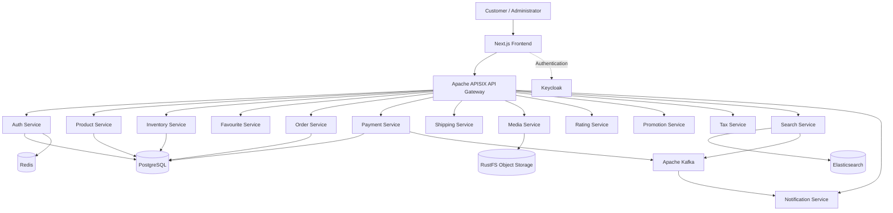

# E-Commerce Microservices Application

A scalable, containerized e-commerce platform built using **Spring Boot microservices, Next.js, Apache APISIX, Keycloak, PostgreSQL, Apache Kafka, Elasticsearch, Redis, and Docker Compose**.

The project demonstrates a distributed e-commerce architecture with independently organized backend services, centralized API gateway routing, identity management, persistent storage, event-driven communication, and separate customer and administrative interfaces.

## Project Information

| Field | Details |
|---|---|
| Project Name | E-Commerce Microservices Application |
| Developer | Kambhampati Gopi Sai |
| GitHub | [@kgopi122](https://github.com/kgopi122) |
| Architecture | Microservices |
| Backend | Java 21, Spring Boot |
| Frontend | Next.js, React, TypeScript |
| API Gateway | Apache APISIX |
| Authentication | Keycloak, OAuth 2.0 / OpenID Connect, JWT |
| Database | PostgreSQL |
| Messaging | Apache Kafka |
| Search | Elasticsearch |
| Object Storage | RustFS (S3-compatible) |
| Caching | Redis |
| Containerization | Docker, Docker Compose |
| Package Management | pnpm, Turborepo |

## Table of Contents

- [Overview](#overview)
- [Features](#features)
- [System Architecture](#system-architecture)
- [Technology Stack](#technology-stack)
- [Microservices](#microservices)
- [Prerequisites](#prerequisites)
- [Getting Started](#getting-started)
- [Environment Configuration](#environment-configuration)
- [Accessing the Application](#accessing-the-application)
- [Running the Frontend Separately](#running-the-frontend-separately)
- [Testing and Verification](#testing-and-verification)
- [Troubleshooting](#troubleshooting)
- [Security Considerations](#security-considerations)
- [Known Limitations](#known-limitations)
- [Future Enhancements](#future-enhancements)
- [Contributing](#contributing)
- [Author](#author)

## Overview

This project implements an e-commerce platform using a microservices architecture. Instead of placing all backend functionality in one application, the system separates business capabilities into independent services.

The services communicate through REST APIs and Kafka events where supported. Apache APISIX provides a central API gateway, while Keycloak manages identity and access control.

Docker Compose provides a convenient way to run the application and its supporting infrastructure locally.

The project is intended for learning, development, integration testing, and demonstrating practical knowledge of microservices, distributed systems, backend development, and containerized applications.

## Features

### Customer-facing functionality

- Product browsing and product details
- Product category navigation
- Product search and autocomplete
- Shopping cart and order management
- Favourite products
- Product ratings and reviews
- Payment management
- Shipping-related operations
- Product image and media management
- Promotional offers and tax-related functionality
- User authentication and authorization

### Administrative functionality

- Administrative frontend
- Role-based access control
- Product and category management, subject to configured permissions
- Management interfaces for supported backend capabilities

### Platform and infrastructure

- Independently organized Spring Boot services
- Centralized API routing through APISIX
- Keycloak-based authentication
- PostgreSQL persistence
- Kafka-based asynchronous event processing
- Elasticsearch-powered search
- Redis caching
- S3-compatible object storage through RustFS
- Containerized development environment
- Automated service startup and dependency management through Docker Compose

*Feature availability depends on the current implementation of each service. See Known Limitations before treating the platform as production-ready.*

## System Architecture



*The diagram illustrates the major components and intended integration paths. Not every connection represents a fully implemented production workflow.*

### Architecture principles

- **Service separation:** Business capabilities are organized into distinct backend services.
- **API gateway:** Client API requests are routed through APISIX where configured.
- **Identity management:** Keycloak handles authentication, with authorization enforced by the applicable services.
- **Data persistence:** PostgreSQL stores relational application data.
- **Asynchronous communication:** Kafka supports event-driven communication for implemented workflows.
- **Search infrastructure:** Elasticsearch supports product search capabilities.
- **Object storage:** RustFS provides S3-compatible storage for media assets.
- **Containerization:** Docker Compose manages the local application environment.

## Technology Stack

| Layer | Technologies |
|---|---|
| Frontend | Next.js, React, TypeScript |
| Frontend tooling | pnpm, Turborepo |
| Backend | Java 21, Spring Boot 3.3.x |
| API Gateway | Apache APISIX 3.9.x |
| Identity and Access | Keycloak 26.x, JWT, OAuth 2.0, OpenID Connect |
| Relational Database | PostgreSQL 16 |
| Message Broker | Apache Kafka 3.9.x |
| Search Engine | Elasticsearch 8.15.x |
| Cache | Redis |
| Object Storage | RustFS |
| Infrastructure | Docker, Docker Compose |
| Testing | Service-specific unit and integration tests |

Version numbers represent the versions used in the project configuration and may differ if the repository has subsequently been updated.

## Microservices

| Service | Default Port | Responsibility |
|---|---:|---|
| Auth Service | 8088 | User-related API and authentication integration |
| Favourite Service | 8081 | Favourite product management |
| Inventory Service | 8082 | Inventory queries |
| Media Service | 8083 | Media and file management |
| Order Service | 8084 | Cart and order operations |
| Payment Service | 8085 | Payment-related operations |
| Product Service | 8086 | Product and category management |
| Shipping Service | 8087 | Shipping-related operations |
| Rating Service | 8089 | Product ratings |
| Notification Service | 8090 | Notification and event processing |
| Tax Service | 8091 | Tax-related operations |
| Promotion Service | 8093 | Promotional offers |
| Search Service | 8094 | Product search and autocomplete |
| Keycloak | 8080 | Identity and access management |
| APISIX Gateway | 9080 | API gateway |
| PostgreSQL | 5432 | Relational database |
| Kafka | 9092 | Event streaming |
| Elasticsearch | 9200 | Search and indexing |
| RustFS | 9000 / 9001 | Object storage and console/API access |
| Redis | 6379 | Cache and supporting data |

These are expected local ports. Confirm the actual host-port mappings in `docker-compose.yml` before using them, especially if another application occupies a port.

## Prerequisites

Install the following software before starting the project:

1. **Git** — to clone the repository.
2. **Docker Desktop** — with the Docker Engine running and Compose available.
3. **Node.js** — a version compatible with the frontend's `package.json` and project configuration.
4. **pnpm** — the package manager used by the frontend monorepo.
5. **Java 21 and Maven** — for building backend services locally, if the project uses Maven wrappers or Maven-based builds.

For the Docker-based setup, Java and Maven may not be needed on the host if all backend services run from existing container images.

Verify the main tools:

```bash
git --version
docker --version
docker compose version
node --version
pnpm --version
```

Verify that Docker Desktop is running:

```bash
docker info
```

## Getting Started

### Step 1: Clone the repository

Open PowerShell, Command Prompt, or a terminal and run:

```bash
git clone https://github.com/kgopi122/Ecommerce-Application-Microservices.git
```

Navigate to the project directory:

```bash
cd Ecommerce-Application-Microservices
```

If the repository contains a different top-level directory name, enter the directory created by the clone command.

### Step 2: Inspect the project structure

```text
Ecommerce-Application-Microservices/
├── frontend/
│   ├── apps/
│   │   ├── web/
│   │   └── admin/
│   ├── packages/
│   └── package.json
├── auth-service/
├── product-service/
├── inventory-service/
├── favourite-service/
├── media-service/
├── order-service/
├── payment-service/
├── shipping-service/
├── rating-service/
├── notification-service/
├── tax-service/
├── promotion-service/
├── search-service/
├── common-lib/
├── deploy/
│   └── apisix/
├── docker-compose.yml
└── README.md
```

This is a representative structure. Some directories, build files, or deployment folders may differ in the current repository.

### Step 3: Configure environment variables

Inspect the configuration files and environment variable references before starting the application.

Typical files to check include:

- `docker-compose.yml`
- `.env.example`, if provided
- Service-specific `.env` files, if required
- Spring Boot `application.yml` files
- Frontend environment configuration
- Keycloak realm and client configuration

If an example environment file is provided, copy it and fill in the required local values. For example, in PowerShell:

```powershell
Copy-Item .env.example .env
```

Run this command only if `.env.example` exists in that directory.

Do not commit actual passwords, client secrets, access tokens, or other credentials to GitHub.

### Step 4: Start the backend and infrastructure

From the directory containing `docker-compose.yml`, run:

```bash
docker compose up -d
```

Docker Compose will download the configured images if they are not already available and create or start the configured containers.

Check their status:

```bash
docker compose ps
```

Inspect the logs if a service fails to start:

```bash
docker compose logs --tail=100
```

To follow logs for a particular service:

```bash
docker compose logs -f product-service
```

Replace `product-service` with the service you need to inspect.

**Important:** A container marked `Started` does not necessarily mean its application is fully ready. Check health status and logs before testing the application.

### Step 5: Start the frontend if it is not included in Docker Compose

Open a separate terminal:

```bash
cd frontend
```

Enable pnpm through your existing Node.js package-manager setup if necessary. Then install the dependencies:

```bash
pnpm install
```

Start the configured development applications:

```bash
pnpm run dev
```

If the repository uses a different script or a specific workspace command, follow the scripts in the root `package.json` and the relevant app's `package.json`.

If Docker Compose already starts the frontend, do not start a second copy on the same port unless you intentionally configure a separate development port.

## Environment Configuration

Use the existing project configuration as the source of truth.

Common configuration categories include:

| Configuration | Purpose |
|---|---|
| PostgreSQL settings | Database host, database name, credentials |
| Kafka settings | Broker addresses and event topics |
| Keycloak settings | Realm, client ID, issuer and authentication endpoints |
| APISIX settings | Gateway routes and upstream services |
| Elasticsearch settings | Search cluster connection |
| Redis settings | Cache connection |
| RustFS settings | Object storage endpoint, bucket and credentials |
| Frontend API base URL | Public gateway URL used by the browser |
| Service URLs | Internal Docker service addresses used by backend containers |

Inside Docker, services generally communicate using their Compose service names and internal ports. Browser applications must use URLs reachable from the user's browser rather than Docker-only hostnames.

Do not blindly replace existing environment values. Verify them against the actual Compose file, service configuration, and gateway routes.

## Accessing the Application

After the relevant containers start, try the following local addresses:

| Component | URL |
|---|---|
| Storefront | `http://localhost:3000` |
| API Gateway | `http://localhost:9080` |
| Keycloak | `http://localhost:8080` |
| Elasticsearch | `http://localhost:9200` |
| RustFS console/API | `http://localhost:9001` / `http://localhost:9000` |

These URLs assume the corresponding ports are published to the host. If the storefront does not open at port `3000`, inspect the Compose configuration:

```bash
docker compose ps
docker port frontend
```

Use the configured Keycloak realm and client rather than assuming that a particular login URL or administrator credential exists.

## Running the Frontend Separately

For frontend development, use a separate terminal and navigate to `frontend/`.

Install dependencies:

```bash
pnpm install
```

Start the configured development environment:

```bash
pnpm run dev
```

Check the monorepo scripts if this command does not start both applications:

```bash
pnpm run
```

The repository contains storefront and administrative frontend workspaces. Use the actual workspace names and scripts defined in `package.json` when starting one application independently.

If the frontend uses a Vite or Next.js proxy, ensure that its target points to the intended gateway or backend endpoint. Avoid hardcoding machine-specific IP addresses.

## Testing and Verification

### Check Docker services

```bash
docker compose ps
```

Review the logs of a service with problems:

```bash
docker compose logs --tail=100 auth-service
docker compose logs --tail=100 product-service
docker compose logs --tail=100 apisix
```

### Check frontend quality

From the `frontend/` directory, use the scripts defined in the relevant workspace. Typical commands may include:

```bash
pnpm run lint
pnpm run build
```

These commands should be run from the workspace where the scripts are defined. If the root scripts do not expose them, use the corresponding application workspace scripts.

### Recommended manual checks

- Open the storefront and verify public product browsing.
- Check that product data and images load correctly.
- Test category navigation and product search.
- Verify login and logout through Keycloak.
- Refresh the browser and verify authentication state.
- Test favourites, cart, and order operations.
- Verify that unauthorized users cannot access protected functionality.
- Test administrative access using the appropriate roles.
- Inspect browser developer tools for failed API requests, authentication errors, and image-loading errors.

Do not treat successful container startup or compilation alone as proof that all workflows are working.

## Troubleshooting

### Docker cannot bind port 8080

Another process may already be using the port required by Keycloak.

On Windows PowerShell:

```powershell
netstat -ano | findstr :8080
```

Identify the process using the reported PID:

```powershell
tasklist /FI "PID eq <PID>"
```

Stop the conflicting application only after confirming that it is safe to do so. Alternatively, change the published host port and update any dependent browser-facing configuration consistently.

### A container fails to start

Check its status and logs:

```bash
docker compose ps -a
docker compose logs --tail=150 <service-name>
```

Resolve the actual configuration, startup, or dependency error before restarting the entire application repeatedly.

### Docker image download times out

Retry:

```bash
docker compose pull
docker compose up -d
```

Check the network connection, VPN, proxy, firewall, and Docker Desktop status if downloads repeatedly fail.

### Frontend cannot reach the backend

Verify:

- The gateway container is running.
- The expected API route exists in APISIX.
- The frontend API base URL is correct.
- Browser-facing URLs do not use Docker-only hostnames.
- Required services are healthy.
- CORS and authentication configuration match the intended request flow.

### Login redirects repeatedly or an API returns 401

Inspect the browser Network panel and the relevant gateway, auth-service, and Keycloak logs.

Check token presence and expiry, the endpoint's authorization requirements, issuer configuration, gateway routing, and frontend route guards. Do not disable JWT validation or make protected endpoints public as a workaround.

### Product images are missing

Check the product API response, media-service configuration, RustFS object availability, image URLs, and Next.js image-host configuration. Use a deliberate fallback when an image is unavailable.

### Frontend package-manager errors

The repository uses pnpm and Turborepo. Use the expected Node.js and pnpm versions and preserve the existing lockfile. Avoid replacing pnpm with npm or deleting the lockfile as a first troubleshooting step.

## Security Considerations

- Never commit `.env` files containing real secrets.
- Do not publish database passwords, API tokens, or Keycloak client secrets.
- Keep JWT verification and role-based authorization enabled.
- Use strong credentials for locally exposed administrative services.
- Restrict production access to database, cache, search, object storage, and gateway administration ports.
- Use HTTPS and production-grade secrets management for deployed environments.
- Review container permissions, image provenance, network exposure, and dependency vulnerabilities before deployment.

## Known Limitations

Some distributed workflows require further integration before the application can be considered production-ready:

- The product search indexing pipeline requires a working event or CDC integration.
- Inventory reservation and stock mutation workflows need complete implementation and validation.
- End-to-end order orchestration across inventory, tax, payment, and shipping requires further integration.
- Some notification topics may lack an active producer.
- Certain tax-related operations depend on location functionality that may not be available.
- External carrier integrations and a complete shipment lifecycle require additional work.
- Service URL and identity-provider configuration must be validated in the target environment.

These limitations should be reassessed against the current source code before each release. A successful local startup does not establish production readiness.

## Future Enhancements

Potential improvements include:

- Complete order lifecycle orchestration and reliable stock reservation.
- Implement an event-driven search indexing pipeline.
- Add retry policies, dead-letter handling, and idempotent event processing.
- Improve observability through centralized logs, metrics, and distributed tracing.
- Expand automated unit, integration, contract, and end-to-end testing.
- Add CI/CD pipelines and automated security scanning.
- Introduce production deployment manifests and environment-specific configuration.
- Improve image optimization, accessibility, localization, and storefront performance.
- Add resilience testing, load testing, and documented disaster-recovery procedures.

## Contributing

Contributions, bug reports, and suggestions are welcome.

1. Fork the repository.
2. Create a feature branch:

   ```bash
   git checkout -b feature/your-feature-name
   ```

3. Make your changes and add appropriate tests.
4. Run the relevant lint, test, and build commands.
5. Commit your changes:

   ```bash
   git add .
   git commit -m "feat: describe your change"
   ```

6. Push the branch:

   ```bash
   git push origin feature/your-feature-name
   ```

7. Open a pull request with a clear description of the change and its test results.

Follow the existing code conventions and preserve the microservices architecture.

## Author

**Kambhampati Gopi Sai**

GitHub: [@kgopi122](https://github.com/kgopi122)

Project repository: [E-Commerce Microservices Application](https://github.com/kgopi122/Ecommerce-Application-Microservices)

---

If you find an issue, please open a GitHub issue with the relevant logs, reproduction steps, and expected behavior.

