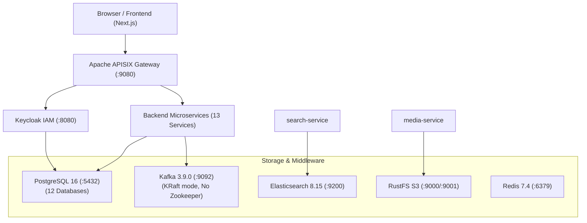

# Architecture Audit Summary

## Executive Overview
This repository implements an e-commerce platform built with a microservices architecture using **Java 21**, **Spring Boot 3.3.5**, **Apache APISIX 3.9.1**, **Keycloak 26.0**, **PostgreSQL 16**, **Apache Kafka 3.9.0 (KRaft mode)**, **Elasticsearch 8.15.0**, **RustFS (S3-compatible Object Storage)**, and a **Next.js monorepo frontend (pnpm + Turbo)**.

---

## Service Inventory Table

| Service Name | Port | Context Path | Main Technology / Stack | Primary Data Store / Schema | Inbound Route (APISIX / Direct) | Outbound Dependencies |
| :--- | :--- | :--- | :--- | :--- | :--- | :--- |
| **auth-service** | `8088` | `/auth` | Java 21, Spring Boot 3.3.5, Spring Security, Keycloak Admin Client, Liquibase | PostgreSQL (`authservice`) | `/api/v1/auth/*`, `/api/v1/users/*`, `/api/v1/roles/*` | Keycloak (`http://keycloak:8080`) |
| **product-service** | `8086` | `/product` | Java 21, Spring Boot 3.3.5, Spring Data JPA, Liquibase | PostgreSQL (`productservice`) | `/api/products/*`, `/api/categories/*` | None |
| **order-service** | `8084` | `/order` | Java 21, Spring Boot 3.3.5, Spring Data JPA, RestClient, Liquibase | PostgreSQL (`orderservice`) | `/api/orders/*`, `/api/carts/*` | `auth-service`, `product-service` |
| **payment-service** | `8085` | `/payment` | Java 21, Spring Boot 3.3.5, Spring Data JPA, KafkaTemplate, RestClient | PostgreSQL (`paymentservice`) | `/api/payments/*` | `order-service` (`http://ORDER-SERVICE`), `auth-service` (`http://AUTH-SERVICE`), Kafka |
| **shipping-service** | `8087` | `/shipping` | Java 21, Spring Boot 3.3.5, Spring Data JPA, RestClient, Liquibase | PostgreSQL (`shippingservice`) | `/shipping/api/shippings/*` | `product-service` (`http://localhost:8830`), `order-service` (`http://localhost:8300`) |
| **inventory-service** | `8082` | `/inventory` | Java 21, Spring Boot 3.3.5, Spring Data JPA, Liquibase | PostgreSQL (`inventoryservice`) | `/api/inventory/*` | None |
| **favourite-service** | `8081` | `/favourite` | Java 21, Spring Boot 3.3.5, Spring Data JPA, Liquibase | PostgreSQL (`favouriteservice`) | `/api/favourites/*` | None |
| **rating-service** | `8089` | `/rating` | Java 21, Spring Boot 3.3.5, Resilience4j, RestClient, Liquibase | PostgreSQL (`ratingservice`) | `/storefront/ratings/*`, `/rating/backoffice/ratings/*` | `ecommerce.services.product`, `customer`, `order` |
| **media-service** | `8083` | `/media` | Java 21, Spring Boot 3.3.5, AWS SDK v2, Spring Data JPA | PostgreSQL (`mediaservice`) + RustFS S3 | `/media/medias/*` | RustFS (`http://rustfs:9000`) |
| **tax-service** | `8091` | `/tax` | Java 21, Spring Boot 3.3.5, Spring Data JPA, Liquibase | PostgreSQL (`taxservice`) | `/tax/backoffice/tax-classes/*`, `/tax/backoffice/tax-rates/*` | `ecommerce.services.location` |
| **promotion-service** | `8093` | `/promotion` | Java 21, Spring Boot 3.3.5, Resilience4j, RestClient, Liquibase | PostgreSQL (`promotionservice`) | `/promotion/backoffice/promotions/*` | `ecommerce.services.product` |
| **search-service** | `8094` | `/search` | Java 21, Spring Boot 3.3.5, Spring Data Elasticsearch, KafkaListener | Elasticsearch (`product` index) | `/storefront/catalog-search`, `/storefront/search_suggest` | `product-service`, Kafka (`dbproduct.public.product`), Elasticsearch |
| **notification-service** | `8090` | `/notification` | Java 21, Spring Boot 3.3.5, Spring Mail, KafkaListener, KafkaTemplate | PostgreSQL (`ecommerce`) | `/notification/api/email/*`, `/notification/api/notifications/*` | Kafka, SMTP (`smtp.gmail.com`) |

---

## Infrastructure Map

---

## Key Architecture & Data Design Highlights

1. **API Gateway & Routing**:
   - Replaced Spring Cloud Gateway & Eureka with **Apache APISIX 3.9.1**.
   - Standalone configuration (`deploy/apisix/apisix.yaml`) routes frontend calls directly to upstream backend containers.
   - Global CORS, rate-limiting, and OpenID Connect (OIDC) JWT validation are enforced at the APISIX layer.

2. **Identity & Access Management (IAM)**:
   - Centered around **Keycloak 26.0** (Realm: `ecommerce`, Client: `ecommerce-client`).
   - `auth-service` manages backend-mediated SSO (Authorization Code flow with PKCE capability) and Keycloak user provisioning via Keycloak Admin REST API.
   - Resource servers decode and validate RS256 JWT tokens issued by Keycloak.

3. **Data Storage & Isolation**:
   - Database per service pattern hosted on a single PostgreSQL 16 server instance containing 12 distinct databases created by `/docker/postgres/init/create-all-databases.sql`.
   - Media storage backed by RustFS (S3 API compliant).
   - Search indexing hosted on Elasticsearch 8.15.0.

4. **Inter-Service Communication**:
   - Synchronous calls utilize Spring 6 `RestClient`.
   - Asynchronous events utilize Kafka topics (`paymentSuccessful`, `profileOnboarding`, `profileOnboarded`, `dbproduct.public.product`).
