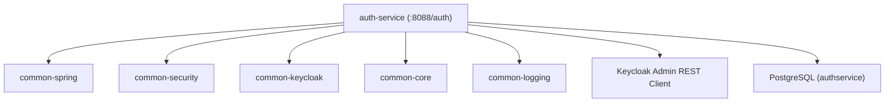
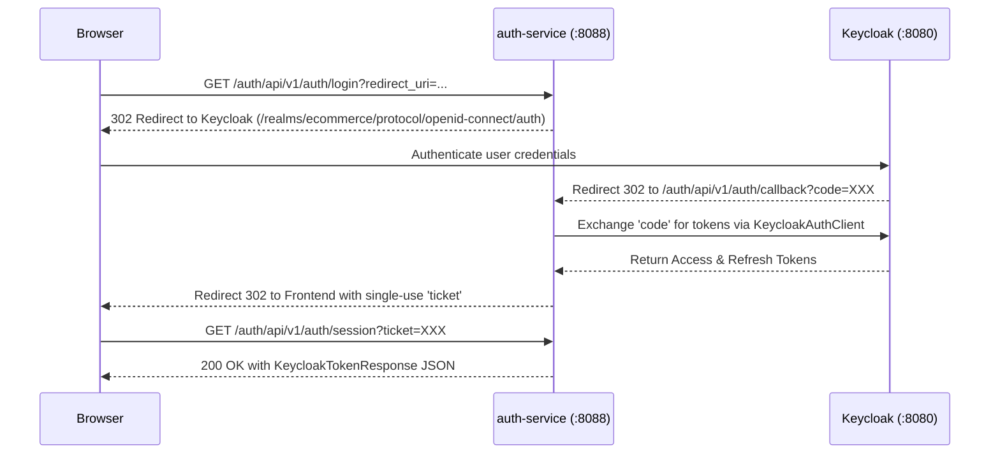

# Auth Service Architecture & Technical Specification

This document details the complete architecture, configuration, dependencies, and security design of `auth-service`.

---

## 1. Executive Summary & Overview
`auth-service` manages user registration, user profile querying/updates, role management, and backend-mediated Single Sign-On (SSO) delegation via **Keycloak 26.0**.

* **Module Location**: `/auth-service`
* **Artifact ID**: `auth-service`
* **Server Port**: `8088`
* **Context Path**: `/auth`
* **Management Port**: `9000` (`/actuator/health`)
* **Primary Data Store**: PostgreSQL database `authservice`
* **Migration Tool**: Liquibase (`db/changelog/db.changelog-master.yaml`)

---

## 2. Technical Stack & Common Library Dependencies

### Module Dependencies
1. `common-core`: Shared DTOs (`ApiResponse`), exception models (`BusinessException`, `ErrorCode`), constants (`ApiPaths`).
2. `common-spring`: Transitive dependency bringing `common-security`, `common-keycloak`, `common-logging`, CORS autoconfiguration, and shared `RestClient.Builder`.
3. `common-security`: Provides `BaseSecurityConfig`, stateless session management, RS256 JWT validation, and `KeycloakRealmRoleConverter`.
4. `common-keycloak`: Auto-wires `KeycloakAuthClient` for token exchange, refresh, logout, and Keycloak Admin API user creation.

---

## 3. Database & Liquibase Architecture

* **Database Name**: `authservice`
* **Database Driver**: `org.postgresql.Driver`
* **JPA Hibernate DDL**: `validate`
* **Liquibase Master**: `classpath:db/changelog/db.changelog-master.yaml`
* **Tables Created**:
  * `roles` (id `BIGINT`, role_name `VARCHAR(60) NOT NULL UNIQUE`)
  * `users` (user_id `BIGINT`, full_name `VARCHAR(100)`, user_name `VARCHAR(100) NOT NULL UNIQUE`, email `VARCHAR(50) NOT NULL UNIQUE`, gender `VARCHAR(255)`, phone_number `VARCHAR(11)`, image_url `TEXT`, keycloak_user_id `VARCHAR(64) UNIQUE`)
  * `user_role` (user_id `BIGINT`, role_id `BIGINT`, Composite Primary Key `(user_id, role_id)`)
* **Seed Data**: Pre-loaded roles `USER` (1), `PM` (2), `ADMIN` (3).

---

## 4. Keycloak Integration & SSO Flow

`auth-service` acts as a backend proxy for OAuth2 Authorization Code flow with Keycloak:

---

## 5. Security & JWT Validation

* **Resource Server**: Spring Security OAuth2 Resource Server.
* **Issuer URI**: `${JWT_ISSUER_URI:http://localhost:8080/realms/ecommerce}`
* **Role Converter**: `KeycloakRealmRoleConverter` parses `realm_access.roles` from JWT into GrantedAuthorities (`ADMIN`, `USER`, `MANAGER`).
* **Public Endpoints**: `/api/v1/auth/**`, `/actuator/health`, `/swagger-ui/**`.
* **Protected Endpoints**: Require valid Bearer JWT.
