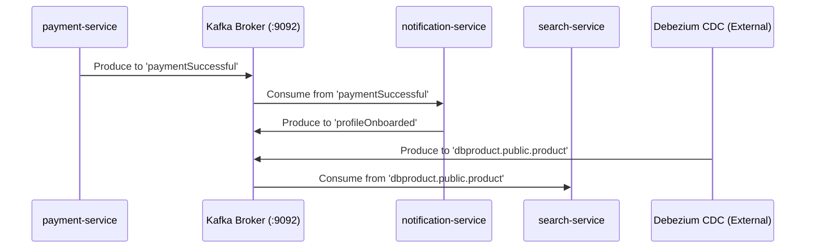

# Kafka Topology & Event Streams

This document details the Apache Kafka configuration, architecture, and topic topology across the e-commerce microservices platform.

---

## 1. Infrastructure Configuration

* **Kafka Version**: Apache Kafka 3.9.0 (`apache/kafka:3.9.0`)
* **Mode**: **KRaft mode** (Kafka Raft Metadata mode — **No ZooKeeper container required or present**)
* **Cluster Architecture**: Single-node combined broker & controller (`KAFKA_NODE_ID: 1`, `KAFKA_PROCESS_ROLES: broker,controller`)
* **Internal Listener**: `PLAINTEXT://kafka:9092`
* **Controller Listener**: `CONTROLLER://kafka:9093`
* **External Port Mapping**: `9092:9092`
* **Environment Configuration**:
  ```yaml
  KAFKA_NODE_ID: 1
  KAFKA_PROCESS_ROLES: broker,controller
  KAFKA_LISTENERS: PLAINTEXT://:9092,CONTROLLER://:9093
  KAFKA_ADVERTISED_LISTENERS: PLAINTEXT://kafka:9092
  KAFKA_LISTENER_SECURITY_PROTOCOL_MAP: PLAINTEXT:PLAINTEXT,CONTROLLER:PLAINTEXT
  KAFKA_CONTROLLER_LISTENER_NAMES: CONTROLLER
  KAFKA_CONTROLLER_QUORUM_VOTERS: 1@kafka:9093
  ```

---

## 2. Topic Inventory & Messaging Flow



---

## 3. Topic Specifications

| Topic Name | Producer Component | Consumer Component(s) | Event Payload Schema | Production Mechanism | Purpose |
| :--- | :--- | :--- | :--- | :--- | :--- |
| `paymentSuccessful` | `payment-service` | `notification-service` | `KafkaPaymentDto` (orderId, amount, customerEmail) | Application Code (`KafkaTemplate.send`) | Triggers email notification for completed order payment |
| `profileOnboarding` | *None active in repo* | `notification-service` | User onboarding JSON | *Unproduced* (commented out in payment-service) | Intended to trigger customer welcome email |
| `profileOnboarded` | `notification-service` | External / Audit | Notification status JSON | Application Code (`KafkaTemplate.send`) | Signals successful delivery of customer notification |
| `dbproduct.public.product` | **Debezium CDC Connector** | `search-service` | Debezium Change Event JSON (`op`: c/u/d, `key`: `{id}`, `value`: `{op, after}`) | **PostgreSQL Write-Ahead Log (WAL) capture** | Syncs PostgreSQL product table changes into Elasticsearch |

---

## 4. Analysis of `dbproduct.public.product` CDC Pipeline
* **Source**: Produced by **Debezium PostgreSQL Connector** inspecting the PostgreSQL WAL log for `productservice.product`.
* **Consumer**: `search-service`'s `ProductSyncDataConsumer` parses the Debezium envelope `op` field (`c` = CREATE, `u` = UPDATE, `d` = DELETE) and calls `ProductSyncDataService` to update Elasticsearch.
* **Infrastructure Gap**: Neither `docker-compose.yml` nor `k8s/infra` includes a Kafka Connect / Debezium container. Therefore, `dbproduct.public.product` will not receive automatic CDC events unless an external Kafka Connect process is deployed.
