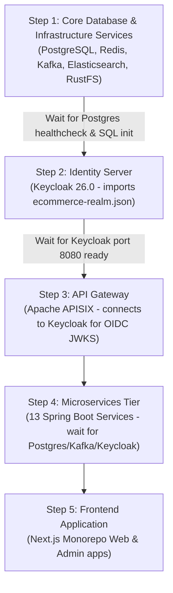

# System Startup & Dependency Order

This document outlines the strict technical startup sequence required to launch the e-commerce microservices platform without container crashes or initialization failures.

---

## Startup Sequence

---

## Detailed Step Breakdown

### Step 1: Core Infrastructure
* **Services**: `postgres`, `redis`, `kafka`, `elasticsearch`, `rustfs`
* **Verification / Health Check**:
  * PostgreSQL: `pg_isready -U postgres -d ecommerce` (verifies initial DB script `/docker/postgres/init/create-all-databases.sql` completed creating 12 databases).
  * Redis: `redis-cli ping`.
  * Kafka: `kafka-topics.sh --bootstrap-server localhost:9092 --list`.
  * Elasticsearch: `curl -f http://localhost:9200/_cluster/health`.
  * RustFS: `curl -f http://localhost:9000/health`.

### Step 2: Identity & Security Layer
* **Service**: `keycloak`
* **Prerequisites**: `postgres` service MUST be healthy (`KC_DB_URL_DATABASE=keycloak`).
* **Command / Behavior**: `start-dev --http-port=8080 --import-realm`
* **Verification**: HTTP 200 at `http://localhost:8080/realms/ecommerce/.well-known/openid-configuration`.

### Step 3: API Gateway
* **Service**: `apisix`
* **Prerequisites**: `keycloak` MUST be healthy (APISIX openid-connect plugin resolves `http://keycloak:8080/realms/ecommerce/.well-known/openid-configuration` at startup).
* **Verification**: Port 9080 accepting connections (`curl http://localhost:9080`).

### Step 4: Backend Microservices Tier
The 13 microservices can be launched once infrastructure & Keycloak are online:
1. `auth-service` (requires `postgres` DB `authservice`, `keycloak`)
2. `product-service` (requires `postgres` DB `productservice`)
3. `inventory-service` (requires `postgres` DB `inventoryservice`)
4. `order-service` (requires `postgres` DB `orderservice`, `kafka`)
5. `payment-service` (requires `postgres` DB `paymentservice`, `kafka`)
6. `shipping-service` (requires `postgres` DB `shippingservice`)
7. `favourite-service` (requires `postgres` DB `favouriteservice`)
8. `rating-service` (requires `postgres` DB `ratingservice`)
9. `media-service` (requires `postgres` DB `mediaservice`, `rustfs`)
10. `tax-service` (requires `postgres` DB `taxservice`)
11. `promotion-service` (requires `postgres` DB `promotionservice`)
12. `search-service` (requires `elasticsearch`, `kafka`)
13. `notification-service` (requires `postgres` DB `ecommerce`, `kafka`)

### Step 5: Frontend Tier
* **Service**: `frontend` (Next.js monorepo containing Web storefront and Admin apps).
* **Prerequisites**: APISIX Gateway (`NEXT_PUBLIC_API_URL=http://localhost:9080` or `http://api.ecommerce.local`).
